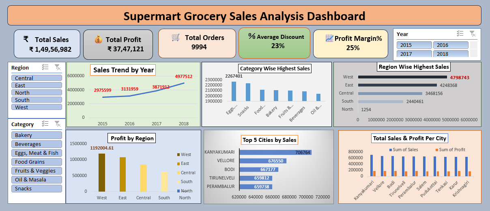

# Supermart Grocery Sales Analysis Dashboard
## Project Overview
The Supermart Grocery Sales Analysis Dashboard is an Excel-based Data Analytics project designed to analyze grocery sales, profitability, discounts, orders, product categories, regions, and city-level performance.
The dashboard presents key performance indicators and visualizations to help stakeholders understand sales trends and identify business performance patterns.
## Objectives
- Analyze total sales, total profit, and total orders.
- Track yearly sales trends.
- Compare sales across product categories.
- Identify high-performing regions and cities.
- Analyze profit by region.
- Review average discount and profit margin.
## Tools Used
- Microsoft Excel
- Pivot Tables and Pivot Charts
- Excel formulas
- Slicers and interactive filters
- Data visualization
## Key Performance Indicators (KPIs)
- Total Sales
- Total Profit
- Total Orders
- Average Discount
- Profit Margin %
## Dashboard Features
- Year-wise Sales Trend
- Category-wise Sales
- Region-wise Sales
- Profit by Region
- Top 5 Cities by Sales
- Total Sales and Profit by City
- Interactive Year, Region, and Category filters
## Business Questions
1. How do sales change over the years?
2. Which product categories generate the highest sales?
3. Which regions contribute the most sales and profit?
4. Which five cities have the highest sales?
5. What are the overall profit margin and average discount?
## Project Structure
- `dashboard/` — Excel dashboard workbook.
- `screenshots/` — Dashboard preview image.
- `data/` — Source dataset, if shareable.
- `documentation/` — Additional project documentation.
## Dashboard Preview

## Conclusion
This project demonstrates Excel-based data analysis, KPI reporting, interactive filtering, and business performance visualization.
## Author
Bomma Nikhitha
